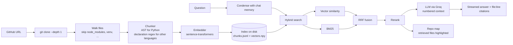

# 🧭 Codebase RAG

**Paste a GitHub URL, index it, and chat with the code. Every answer cites the exact file and line range it came from.**

<!-- TODO(Hewan): record a 15-second GIF of the app (index a repo -> ask a question -> open the Repo map tab),
     save it as docs/demo.gif and uncomment the next line.
 -->

[](https://github.com/hewansirak/Codebase-RAG/actions)


**Live demo:** _add your Streamlit Community Cloud link here after deploying (see [Deploy](#deploy))_

## Features

- **Function-level chunking** – Python is split with the `ast` module into functions, methods and classes; JS/TS/Go/Rust/Java and others are split at top-level declarations using regular expressions; everything else falls back to overlapping line windows. Every chunk keeps its file path and start/end line.
- **Hybrid search** – BM25 (with a code-aware tokenizer that splits `camelCase` and `snake_case`) and dense vector search, merged with Reciprocal Rank Fusion.
- **Reranking** – a lightweight heuristic reranker by default (boosts symbol and path matches); an optional cross-encoder reranker (`CrossEncoderReranker`) is included in the `ml` extra.
- **Metadata filters** – restrict by repository, language, chunk kind or path prefix.
- **Cited answers** – the LLM is instructed to cite `[n]`; the UI shows only the cited excerpts with file path and line numbers.
- **Conversation memory** – follow-up questions are rewritten into standalone search queries using the last turns.
- **Multiple codebases** – index several repositories and chat with one or several at once.
- **Streamlit UI** – index with a progress bar, streaming answers, citation panel, repo selector.
- **Repo map** – an interactive treemap of the repository that highlights the files retrieved for the latest answer.
- **Push-to-reindex webhook** – a small server that verifies GitHub's HMAC signature and re-indexes on pushes to the default branch.
- **Retrieval eval** – `hit_rate@k`, `recall@k` and MRR over a labelled JSONL question set.
- **Works without an API key** – falls back to retrieval-only mode and shows the matching code.

## Architecture



## Tech stack

Python 3.10+, Streamlit, NumPy, Plotly, sentence-transformers (`all-MiniLM-L6-v2`), Groq (OpenAI-compatible API, `llama-3.3-70b-versatile`), pytest, Ruff, GitHub Actions.

## Quick start

```bash
git clone https://github.com/hewansirak/Codebase-RAG && cd Codebase-RAG
python -m venv .venv && source .venv/bin/activate      # Windows: .venv\Scripts\activate
pip install -e ".[ml,dev]"
cp .env.example .env                                   # add GROQ_API_KEY (optional)
streamlit run app.py
```

Command-line equivalents:

```bash
python -m codebase_rag index https://github.com/owner/repo
python -m codebase_rag ask "How does authentication work?"
python -m codebase_rag list
python -m codebase_rag eval evals/codebase_rag.jsonl     # retrieval quality on this repo
python -m codebase_rag webhook                           # re-index on GitHub push events
```

Use `--embedder hashing` for a fast, dependency-free baseline (no model download).

## Retrieval quality

`evals/codebase_rag.jsonl` holds 8 questions about this repository's own code. With the dependency-free `hashing` baseline and the heuristic reranker:

| hit rate @5 | recall @5 | MRR |
|---|---|---|
| 1.00 | 1.00 | 0.56 |

This is a small self-test, not a benchmark – write a dataset for your own repository to measure the model you use.

## Project layout

```
codebase_rag/
  ingest.py      clone + file walking
  chunking.py    AST / declaration / window chunkers
  embeddings.py  tokenizer, hashing + sentence-transformers embedders
  store.py       on-disk index
  retrieval.py   BM25, vector search, RRF, filters
  rerank.py      heuristic + cross-encoder rerankers
  generation.py  prompts, memory, streaming, citation extraction
  repomap.py     treemap of retrieved files
  evaluate.py    hit rate / recall / MRR
  webhook.py     push-to-reindex server
app.py           Streamlit UI
notebooks/       original prototype (Colab + Pinecone)
```

## Deploy

1. Push to GitHub.
2. On [Streamlit Community Cloud](https://streamlit.io/cloud) create an app from `app.py`.
3. Add `GROQ_API_KEY` under *Secrets*.

The community tier has limited disk and memory; indexes are stored on local disk and are lost when the app restarts.

## Roadmap

- [ ] Multimodal questions (image upload)
- [ ] Pinecone / pgvector backend for persistent, shared indexes
- [ ] Incremental re-indexing (only changed files)
- [ ] Tree-sitter parsers for non-Python languages
- [ ] Larger eval set and model comparison table

## Origin

Started as a Colab notebook using Pinecone and Groq (kept in `notebooks/prototype.ipynb`) for the Headstarter AI accelerator, then rebuilt as a tested Python package.

## License

MIT
